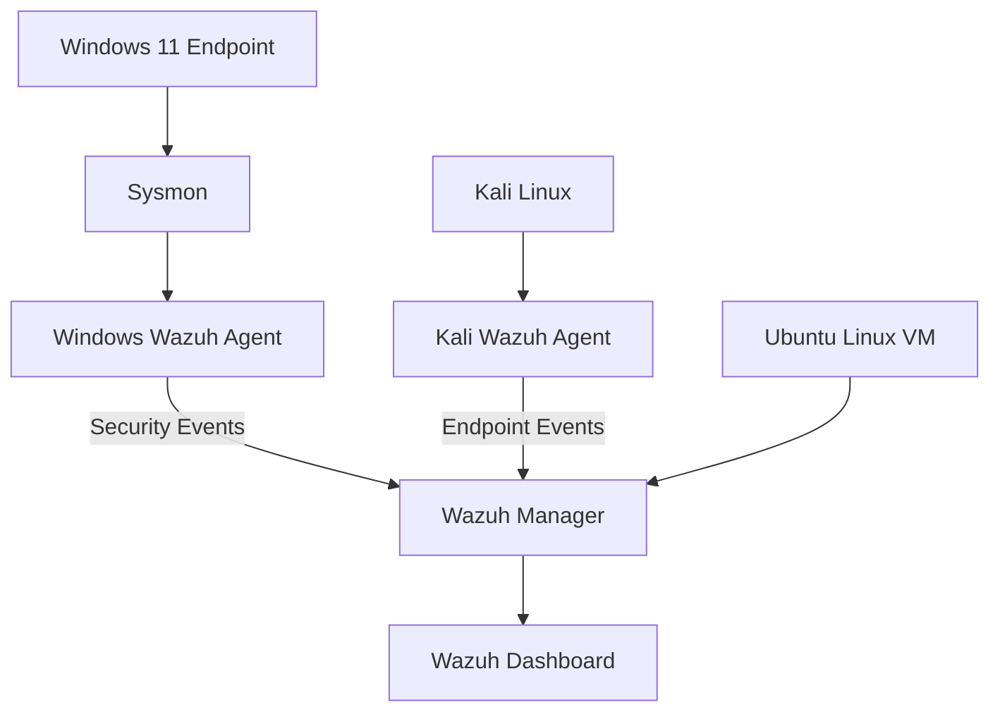

# ThreatLens – SOC Lab Architecture

## Architecture Diagram

## Data Flow

1. Sysmon collects process creation and registry activity on Windows.
2. The Windows Wazuh Agent forwards collected events.
3. The Kali Linux agent provides additional endpoint telemetry.
4. Wazuh Manager analyzes events using built-in and custom rules.
5. The Wazuh Dashboard displays alerts for investigation.